# 🎮 Awesome 3D Graphics & WebGL

### 🚀 A Curated Directory of Real-Time 3D Rendering Engines, WebGPU Pipelines, Modeling Suites, and WebGL Frameworks

  <b>Explore state-of-the-art WebGL, WebGPU, Three.js, Babylon.js, Blender, and Game Engine ecosystems for modern interactive graphics in the browser and beyond.</b>

---

## 📌 Table of Contents

- [🌐 Sector Overview & Market Dynamics](#-sector-overview--market-dynamics)
- [🏢 SaaS & Hosted Commercial Platforms](#-saashosted-commercial-platforms)
- [⚡ Open-Source GitHub Projects](#-open-source-github-projects)
- [🛠️ Architectural Selection Guide](#️-architectural-selection-guide)
- [🤝 How to Contribute](#-how-to-contribute)
- [💖 Support & Sponsorship](#-support--sponsorship)
- [⭐ Star History](#-star-history)
- [📜 Disclaimer](#-disclaimer)

---

## 🌐 Sector Overview & Market Dynamics

The global **3D graphics, rendering, and real-time visualization software market** is estimated at approximately **$3.5B to $5.2B** (with the broader 3D CAD/animation ecosystem exceeding **$25B**) and is projected to expand at an aggressive CAGR of **20% to 25%**. 

Market structure exhibits a **dual dynamic**:
- **High Enterprise Concentration:** A core cluster of entrenched platform titans (NVIDIA, Autodesk, Epic Games, Unity) commands significant market share across enterprise workflows, AAA gaming, film VFX, and industrial digital twins via massive R&D budgets and proprietary formats (such as OpenUSD and proprietary DCC pipelines).
- **Vibrant Functional Fragmentation & Open-Source Disruption:** Concurrently, developer adoption is heavily decentralized across a rich, fast-evolving open-source layer. Frameworks like **three.js**, **Babylon.js**, **Godot Engine**, and **Blender** lead adoption across independent studios, interactive web design, and edge/browser-first WebGPU deployments, challenging high-cost legacy licensing models.

---

## 🏢 SaaS/Hosted Commercial Platforms

| Platform | Company Valuation / Revenue | Pricing (Starting Tier) | Free Tier Limits | Description |
| :--- | :--- | :--- | :--- | :--- |
| **[Amazon Lumberyard / AWS Game Tech](https://www.o3de.org/)** | ~$2.2T Market Cap / ~$107B AWS Rev | Pay-as-you-go AWS services (e.g. EC2 G4dn from $0.526/hr; engine core is free) | Free AWS tier: 12-month access to 750 hrs/month t2.micro/t3.micro + 5 GB S3 storage (O3DE engine source is 100% free under Apache 2.0) | Cloud infrastructure and backend gaming services evolved from Lumberyard; engine core transitioned to the open-source Open 3D Engine (O3DE). |
| **[NVIDIA Omniverse](https://www.nvidia.com/en-us/omniverse/)** | ~$3.0T+ Market Cap / ~$120B+ Rev | $4,500/year per named user (Omniverse Enterprise / AI Enterprise subscription) | Free for individual developers and production development; access limited to community support (Discord/forums) without commercial enterprise SLAs. | Platform for building OpenUSD-based 3D applications, digital twins, and collaborative industrial metaverse pipelines with RTX rendering. |
| **[Autodesk Maya](https://www.autodesk.com/products/maya/overview)** | ~$55B Market Cap / ~$5.5B Rev | $235/month or $1,875/year per user (Maya Indie available at $305/year) | 30-day full-featured free trial (1 user, full software access for 30 days; free renewable educational licenses for students/educators). | Industry-standard 3D modeling, animation, rigging, and simulation software widely used across film, television, and AAA video game production. |
| **[Epic Games (Unreal Engine)](https://www.unrealengine.com/)** | ~$32B Valuation / ~$5.6B Rev | 5% royalty on gross lifetime revenue over $1,000,000 per title; enterprise non-game seats at $1,850/seat/year | 100% free access to all engine features and source code; zero royalties until project surpasses $1,000,000 in gross lifetime revenue. | Premier high-fidelity real-time 3D engine renowned for photorealistic rendering, Nanite virtualized geometry, Lumen lighting, and Blueprints. |
| **[Unity](https://unity.com/)** | ~$8B Market Cap / ~$2.0B Rev | $2,040/seat/year (Unity Pro); Unity Personal is $0 | Free Personal Plan: Full engine functionality valid until individual/organization exceeds $200,000 in trailing 12-month revenue/funding. | Leading real-time engine powering mobile, desktop, VR/AR, and WebGL experiences, featuring a massive asset store and comprehensive cloud services. |
| **[CryEngine (Crytek)](https://www.cryengine.com/)** | Privately held (~$50M–$100M Valuation / ~$30M Rev) | 5% royalty on gross revenue beyond initial threshold | 100% free full-engine access with full source code up to the first $5,000 in gross annual revenue per project royalty-free. | High-end visual fidelity real-time engine built for photorealistic graphics, physics, and performance in simulations and games. |
| **[Blender Studio Services](https://cloud.blender.org/)** | Non-profit foundation (~€3M–€5M Annual Budget) | $17/month (€11.50/month) for individual subscription | Free Blender ID gives access to forum and community tools; core Blender 3D software is 100% free open-source with no usage or export restrictions. | Hosted training, production files, open-movie assets, and cloud collaboration services backing the open-source Blender ecosystem. |
| **[PlayCanvas](https://playcanvas.com/)** | Subsidiary of Snap Inc. (~$15B–$20B Market Cap) | $15/month (Personal Plan) or $50/user/month (Organization Plan) | Free plan: Unlimited public projects, 1 GB account storage, unlimited public collaborators; no private projects or self-hosted builds. | Web-first collaborative WebGL/WebGPU 3D engine and browser-based real-time editor optimized for instant-loading interactive web apps. |

---

## ⚡ Open-Source GitHub Projects

Curated open-source 3D rendering engines, WebGL/WebGPU libraries, and digital content creation software, sorted descending by GitHub_Stars_Count:

1. **[Godot Engine](https://github.com/godotengine/godot)**   
   Feature-complete multi-platform 2D and 3D game engine with dedicated node-based architecture, GDScript, C# support, built-in visual shaders, and first-class WebGL/WebGPU browser export targets.

2. **[three.js](https://github.com/mrdoob/three.js)**   
   The industry-standard JavaScript 3D library for crafting interactive real-time browser graphics. Offers lightweight abstractions over WebGL and native WebGPU backends with extensive post-processing and loader ecosystems.

3. **[Bevy](https://github.com/bevyengine/bevy)**   
   A refreshingly simple data-driven game engine built in Rust, powered by a high-performance Entity Component System (ECS) with modern cross-platform rendering using WGPU.

4. **[PixiJS](https://github.com/pixijs/pixijs)**   
   The HTML5 creation engine delivering hyper-fast 2D and 2.5D visual rendering via WebGL and WebGPU with rich sprite management and particle batching.

5. **[React Three Fiber](https://github.com/pmndrs/react-three-fiber)**   
   A powerful React renderer for three.js that enables building declarative, reusable, and composable 3D scene graphs with state management and ecosystem hooks.

6. **[Babylon.js](https://github.com/BabylonJS/Babylon.js)**   
   Enterprise-ready real-time 3D web engine packed with out-of-the-box physics integrations (Havok), specialized material node editors, comprehensive GUI libraries, and cutting-edge WebGPU support.

7. **[Blender](https://github.com/blender/blender)**   
   The premier open-source 3D creation suite covering the entire pipeline: modeling, sculpting, rigging, 2D/3D animation, simulation, real-time EEVEE rendering, and photorealistic Cycles ray tracing.

8. **[Filament](https://github.com/google/filament)**   
   Google's real-time physically based rendering (PBR) engine designed for Android, iOS, Linux, macOS, Windows, and WebGL/WebAssembly targets.

9. **[A-Frame](https://github.com/aframevr/aframe)**   
   Web framework for building virtual reality (VR) and augmented reality (AR) 3D experiences directly in HTML using an entity-component-system layered over three.js.

10. **[PlayCanvas Engine](https://github.com/playcanvas/engine)**   
    High-performance, lightweight WebGL and WebGPU engine engineered specifically for rapid browser game execution, interactive product configurators, and low-latency mobile web rendering.

11. **[Cesium](https://github.com/CesiumGS/cesium)**   
    Open-source JavaScript platform for world-class 3D globes, geospatial mapping, and high-precision spatial digital twin streaming using 3D Tiles.

12. **[Open 3D Engine (O3DE)](https://github.com/o3de/o3de)**   
    Open-source, fully modular AAA real-time 3D engine stewarded by the Linux Foundation (originating from Amazon Lumberyard) featuring the Atom PBR renderer.

13. **[Regl](https://github.com/regl-project/regl)**   
    Functional and stateless abstraction layer for WebGL that eliminates state machine boilerplate and provides pure declarative GPU drawing routines.

14. **[VTK.js](https://github.com/Kitware/vtk-js)**   
    The JavaScript and WebGL implementation of the renowned Visualization Toolkit (VTK), tailored for complex scientific volumetric computing and medical imaging in the browser.

---

## 🛠️ Architectural Selection Guide

- **Browser-Native 3D Experiences & Web Apps:** Choose **three.js** (or **React Three Fiber** if in a React environment) for broad community support, or **Babylon.js** for an all-in-one batteries-included engine complete with physics, GUI, and node material graphs.
- **High-Performance Multi-Platform Game Dev:** Choose **Godot Engine** for an intuitive, zero-royalty workflow, or **Bevy** for cutting-edge Rust ECS architectures.
- **Asset Creation & Pipeline Generation:** Adopt **Blender** for open-source modeling, procedural shaders, and rigging.
- **Scientific, Medical & Geospatial Visualization:** Use **Cesium** for 3D geospatial datasets and **VTK.js** for medical imaging and volumetric slices.

---

## 🤝 How to Contribute

Contributions are welcome! Please follow these guidelines:

1. 🍴 Fork the repository.
2. 🌿 Create your feature branch (`git checkout -b feature/awesome-addition`).
3. 📝 Add your tool or library to `README.md` keeping the established format (link, Stars_Badge, and descriptive summary).
4. 🚀 Open a Pull Request with a clear description of the project.

---

## 💖 Support & Sponsorship

If this curated list helps you build or research real-time 3D graphics and WebGL/WebGPU applications, please consider supporting the project:

- ⭐ **Star this repository** to improve discoverability for other developers.
- 🍴 **Fork and share** with your developer community.
- ☕ **Buy me a coffee / Sponsor the project:** Support ongoing maintenance via the [GitHub Sponsors Dashboard](https://github.com/sponsors/ishandutta2007).

---

## 📈 Star History

---

## 📜 Disclaimer

- This is a community-curated collection intended for educational and reference purposes; it does not constitute an official product endorsement.
- Real-time graphics development demands careful evaluation of target hardware, browser support matrix, licensing, and asset pipelines.

  Maintained with ❤️ for 3D developers, graphics engineers, technical artists, and open-web enthusiasts.

